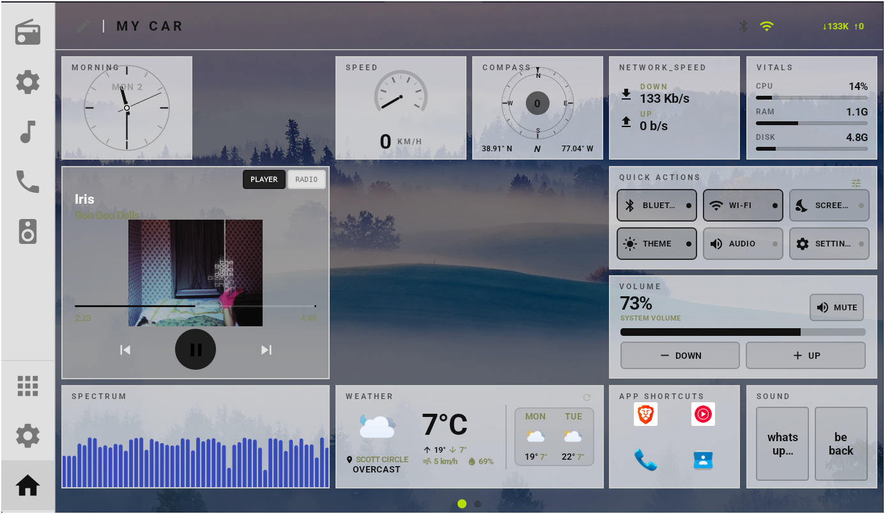
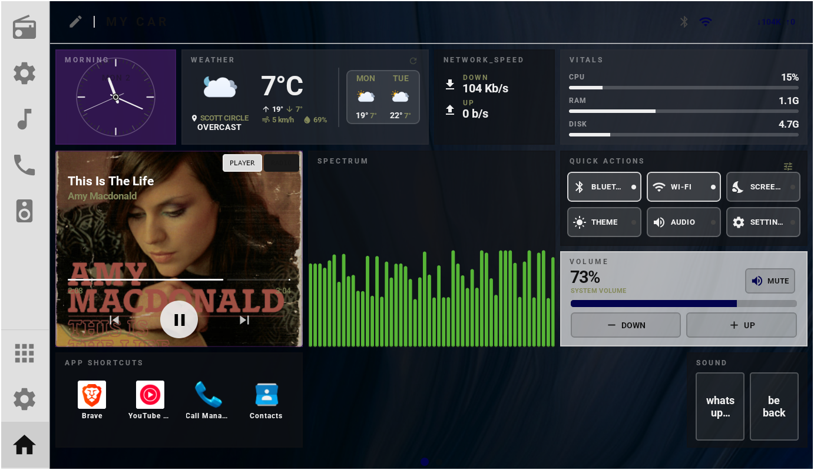
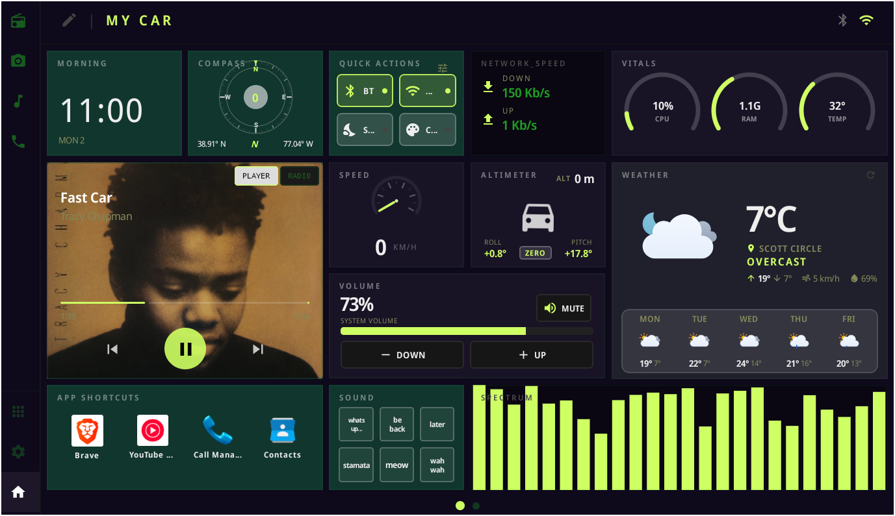
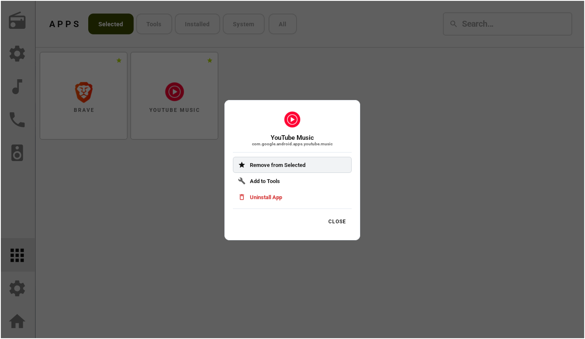
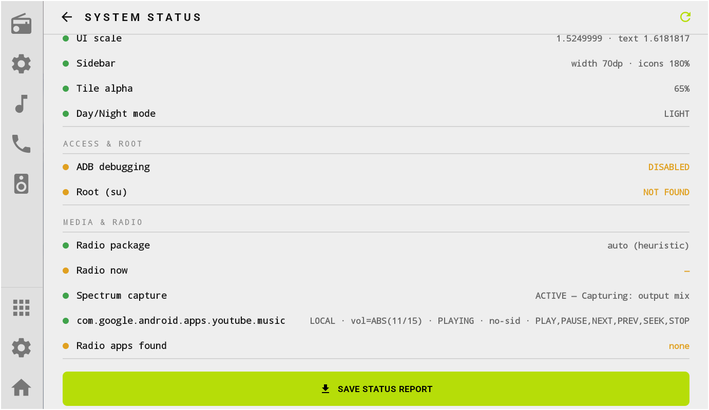
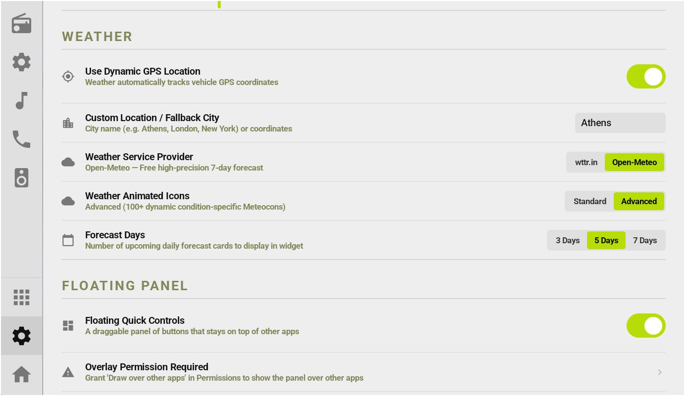
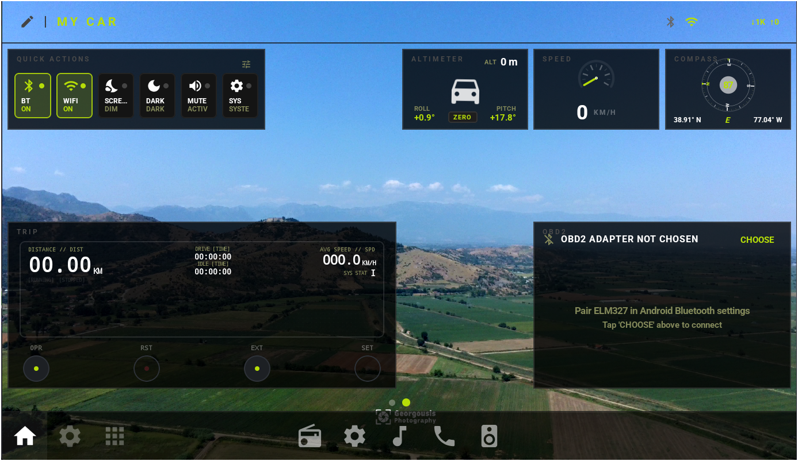
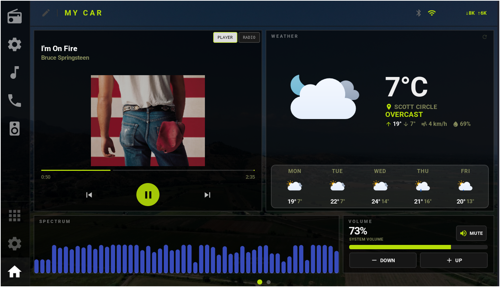

<div align="center">
  
  <h1>Open Launcher (Custom Fork)</h1>
  <p><strong>An open-source, offline-first Android launcher customized and optimized for aftermarket car head units.</strong></p>

  [](https://opensource.org/licenses/MIT)

</div>

---

> [!WARNING]
> **Work in Progress:** This customized fork is actively under development and evolving. While tested on specific hardware, it needs to be thoroughly verified across different Android head units, screen resolutions, and MCU architectures. Feedback, bug reports, and test results from various head units are warmly welcomed!

---

<table>
  <tr>
    <td align="center" width="50%">
      
      <br /><sub><b>Dashboard 3</b></sub>
    </td>
    <td align="center" width="50%">
      
      <br /><sub><b>Dashboard 2</b></sub>
    </td>
  </tr>
  <tr>
    <td align="center" width="50%">
      
      <br /><sub><b>Dashboard 3</b></sub>
    </td>
    <td align="center" width="50%">
      
      <br /><sub><b>App Drawer</b></sub>
    </td>
  </tr>
  <tr>
    <td align="center" width="50%">
      
      <br /><sub><b>System Status</b></sub>
    </td>
    <td align="center" width="50%">
      
      <br /><sub><b>Widget Settings</b></sub>
    </td>
  </tr>
  <tr>
    <td align="center" width="50%">
      
      <br /><sub><b>Dashboard 4</b></sub>
    </td>
    <td align="center" width="50%">
      
      <br /><sub><b>Dashboard 5</b></sub>
    </td>
  </tr>
  
</table>


## Credits & Acknowledgements

This project is built upon the wonderful work of the open-source community:

- **David ([@dw2lam](https://github.com/dw2lam))**: Huge thanks to David for creating the original [Open Launcher](https://github.com/dw2lam/openlauncher). The core launcher architecture, lightweight design, and car-centric foundation originate from his work.  
  **Please consider supporting David for his original work:** [Donate via PayPal](https://paypal.me/dw2lam)
- **itsTwistys ([@itsTwistys](https://github.com/itsTwistys))**: Special thanks to [itsTwistys/openlauncher](https://github.com/itsTwistys/openlauncher) for the great ideas, inspiration, and concepts that guided many of the additional features and enhancements implemented in this fork.

---

## Key Features & Enhancements in This Fork

### Vehicle Integration & Telemetry
- **OBD-II Bluetooth Telemetry Widget (`ObdWidget`)**:
  - Direct connection to ELM327 Bluetooth OBD-II adapters without needing external companion apps.
  - Live vehicle gauges: Engine RPM (`010C`), Speed (`010D`), Coolant Temperature (`0105`), Throttle Position (`0111`), Calculated Engine Load (`0104`), Fuel Level (`012F`), Intake Air Temperature (`010F`), and Battery Voltage (`ATRV`).
  - Redesigned automotive-styled adapter picker dialog with one-click access to system pairing.
  - Robust parser filtering out echoes, prompts, and noisy multi-ECU replies.
- **Car Display Animation & Avatar (`CarAnimation`)**:
  - Set a custom car PNG image on your dashboard.
  - **Drive-by Overlay**: Smooth, full-screen animation where your vehicle drives across the dashboard upon movement detection.

---

### Audio Spectrum Visualizer & Sound Analyzer
- **Real-Time Equalizer Spectrum Widget (`SpectrumWidget`)**:
  - Audio spectrum analyzer with animated dancing bars reacting to playing media.
  - Dual analysis engine via **`SoundVisualizerManager`**:
    - **Native Visualizer Engine**: Attaches directly to active media session IDs or global mix via Android AudioFX for true Fast Fourier Transform (FFT) frequency bands.
    - **Procedural Beat-Reactive Fallback**: Automatically activates if firmware/SELinux prevents direct audio stream access, ensuring fluid, organic equalizer animations without crashing or dropping frames.
  - Visual customization: configurable bar count (8 to 32 bars), sensitivity gain, peak-hold meters, and custom accent/gradient color styling.

---

### Floating Action Panel & Universal Controls
- **System-Wide Floating Assistive Panel (`FloatingPanelService`)**:
  - Overlay floating bubble or dockable bar that stays accessible across any third-party app (navigation, music, OBD apps).
  - Quick hardware actions at your fingertips:
    - Volume Up, Volume Down, and 1-tap Mute toggle.
    - Direct Home shortcut.
    - System Back navigation via Accessibility service (`GlobalActionService`).
    - App Library drawer overlay.
    - Day/Night theme switch.
    - Screen Blackout mode for dark nighttime driving.
  - Draggable, dockable edge snapping with auto-collapsing handle and opacity controls.

---

### Advanced Head Unit Volume Protocols & Calibration
Many Android car head units do not use standard Android audio streams for the physical volume dial. This fork introduces deep head-unit audio integration:
- **Multiple Built-in Volume Protocols**:
  - Standard Android (`STREAM_MUSIC`) — for emulators, phones, and Qualcomm/Snapdragon units.
  - Microntek / MTC (`com.microntek.volumechange`) — for Rockchip PX3, PX5, PX6 units.
  - Junsun / Forfan (`forfan.intent.action.VOLUMESET`).
  - FYT / Joying / SYU (`com.syu.volumechange`).
  - HCT (`com.hct.volumechange`).
  - Rockchip Audio HAL (`av_volume`, `amp_volume`, `mcu_volume`).
- **Hardware Volume Knob Sniffer (`HeadUnitInspector`)**:
  - Non-root, non-ADB diagnostic tool. Watches `Settings.System`/`Settings.Global` changes and system broadcast intents in real time when you turn the physical volume knob to discover your unit's volume protocol.
- **Volume Calibration Wizard (`VolumeCalibrationScreen`)**:
  - Step-by-step interactive test wizard with audio test tones to test each protocol and lock in the right one for your vehicle.

---

### Head-Unit Radio Integration & Station Alerts
- **Hardware & MediaSession Radio Deck**:
  - Full support for head-unit vendor radio apps and MCU tuner broadcasts.
  - Frequency dial, AM/FM band switching, station presets, and steering-wheel seek controls.
- **Station Change Popup (`RadioChangePopup`)**:
  - Unobtrusive floating banner that pops up on frequency/station changes and auto-dismisses after a few seconds.

---

### Network & System Performance
- **Live Network Speed Widget (`NetworkSpeedWidget`)**:
  - Compact real-time speedometer tile tracking instantaneous download and upload transfer rates (`NetworkSpeedManager`).
  - Formats traffic dynamically (KB/s, MB/s) with visual arrows and network connectivity indicators (Wi-Fi, Cellular, Ethernet).

---

### Dual-Page Dashboard & Driving State Auto-Switching
- **Two Independent Home Pages**: Swipe left/right between Page 0 and Page 1, each supporting its own distinct widget grid layout and widget content configurations.
- **Smart Driving Mode Auto-Switch**:
  - Automatically switches to a dedicated "Driving" dashboard page when vehicle GPS speed exceeds a configured threshold (e.g. 8 km/h).
  - Automatically reverts to the "Parked" page when the vehicle has been stopped for a set idle duration (e.g. 10 seconds).

---

### Reworked & New Widgets
- **Expanded Grid (6×4)**: More flexible widget sizing and layout options.
- **Volume Widget (`VolumeWidget`)**: Dedicated tile with quick slider, step controls, mute toggle, and protocol status.
- **Quick Actions Widget (`QuickActionsWidget`)**: 1-tap toggles for Bluetooth, Wi-Fi, Screen Blackout (for night driving), Mute, and Launcher Settings.
- **App Shortcuts Widget (`AppShortcutsWidget`)**: Customizable launcher tile holding 1 to 4 apps with selectable vector icons.
- **Dynamic Weather Widget (`WeatherWidget`)**:
  - High-quality animated weather icons (Meteocons Lottie and SVG vector assets).
  - Dual weather providers: **Open-Meteo** and **wttr.in**.
  - Multi-day forecasts (up to 7 days).
  - GPS-based weather with configurable fallback location (e.g., city name).
- **Custom Soundboard Widget (`SoundboardWidget`)**:
  - Up to 9 configurable audio pads.
  - Preloaded fun audio clips (What's Up Doc, Arnold "I'll be back", A Few Moments Later, Greek Stamata, Cat meow, Horn, Rooster, Boing, Chime) with support for custom audio URIs.
- **Telemetry, Speedometer & Altimeter**: Digital-only options, compass offset calibration, and pitch/roll level calibration.

---

### Diagnostics, Safety & Backup Tools
- **Full Diagnostics Screen (`DiagnosticsScreen`)**: Real-time display of GPS coordinates, altitude, bearing, accuracy, sensors, active media playback sessions, network status, OBD connection status, and head unit hardware/firmware details.
- **Settings Backup & Restore (`SettingsBackup`)**: Versioned JSON export and import for all launcher preferences, coordinates, and widget layouts.
- **SAF Safe Export (`SafeExport`)**: Dual-write verification with internal fallback to prevent 0-byte corrupt exports on unstable head-unit storage providers.
- **Enhanced App Library (`AppLibraryScreen`)**: Filter applications by categories (User, System, Tools, Selected), memory of last selected tab, and direct app uninstall capability.

---

### Personalization & Visual Styling
- **Expanded Fonts**: Includes 8 typography choices: JetBrains Mono, Source Code Pro, Cal Sans, Fugaz One, Geom Variable, Noto Sans Display, Roboto, and System default.
- **Flexible Theming**: Dark, Light, Custom, Auto (day/night based on sunrise/sunset or light sensor), and System modes.
- **Per-Tile Widget Colors**: Each widget can follow the active theme, use default styling, or use a custom background color and transparency.
- **Widget Title Toggle**: Option to toggle widget title headers on or off for a cleaner minimalist appearance.
- **Background Gradients**: Support for Top-to-Bottom, Left-to-Right, Diagonal, and Radial gradients with customizable endpoint colors.
- **Status Indicators Toggle**: Option to hide top-right Bluetooth and Wi-Fi icons if your head unit already displays them in a system status bar.
- **Wallpaper Dimming**: Adjustable dim slider for improved widget legibility over wallpapers.

---

### Build & Release Packaging
- **Automatic APK Artifact Naming**:
  - Custom Gradle build task (`RenameApk`) automatically packages and versions the output APK into `app/build/dist/OpenLauncher_Custom-v<versionName>.apk`.

---

## Building & Installing

### Prerequisites
- Android Studio Ladybug | 2024.2.1 or newer (or command line Gradle)
- Android SDK 36 (minSdk 21, targetSdk 34)
- JDK 17

### Build via Command Line
```bash
# Clone the repository
git clone https://github.com/limbo666/openlauncher_custom.git
cd openlauncher_custom

# Build debug APK
./gradlew assembleDebug

# Build signed release APK
./gradlew assembleRelease
```


---

## Support Original Creators

Please remember to support David for the original project that made this possible:
- **Original Repository:** [https://github.com/dw2lam/openlauncher](https://github.com/dw2lam/openlauncher)
- **Donate to David:** [https://paypal.me/dw2lam](https://paypal.me/dw2lam)
